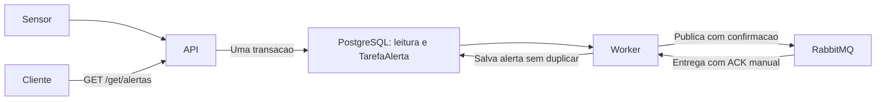

# Fila de mensagens e alertas

O RabbitMQ separa o recebimento das leituras do processamento dos alertas. As APIs continuam respondendo 201 depois de salvar a leitura. Um worker separado verifica regras simples, salva os alertas e permite consulta pelo Ingress.



## Regras de demonstracao

| API | Sensor | Condicao | Ambiente do worker |
|---|---|---|---|
| Alagamento | NIVEL_CORREGO | nivelCorregoCm > 150 cm | ALERTA_NIVEL_CORREGO_CM=150 |
| Qualidade do ar | MP25 | mp25 > 35 microgramas/m3 | ALERTA_MP25=35 |
| Transito | OCUPACAO | ocupacao > 0,80 (80%) | ALERTA_OCUPACAO=0.80 |

Sao limites ilustrativos para demonstrar processamento assincrono; nao representam orientacoes oficiais de seguranca ou saude. Igualdade nao gera alerta. Os outros sete tipos continuam apenas armazenando leituras. Nao ha contagem de leituras consecutivas, episodios ou rearme: cada leitura acima do limite pode gerar um alerta.

O worker valida limites finitos e nao negativos na inicializacao, com ocupacao entre 0 e 1. Os valores vigentes no processamento sao salvos no alerta. Leituras anteriores a esta migration nao geram trabalhos retroativos.

Para alterar limites no Kubernetes, edite `k8s/01-configmap.yaml`, aplique o arquivo e execute `kubectl rollout restart deployment/worker-alertas -n aps`. Os valores sao carregados na inicializacao do processo.

## Organizacao do codigo

Os repositories de leituras salvam leitura e `TarefaAlerta` na mesma transacao, somente para os tres tipos acima. Essa tabela representa trabalhos ainda nao confirmados pelo RabbitMQ. Assim, uma falha entre salvar no banco e enviar para a fila nao perde o trabalho.

Em `shared/alertas/`:

- `alertas.repository.ts`: consultas de tarefas e alertas, gravacao sem duplicidade e verificacao do banco.
- `alertas.service.ts`: validacao das mensagens, limites, comparacao e remocao de tarefas somente apos confirmacao do envio.
- `fila.ts`: conexao AMQP, filas duraveis, mensagens persistentes, confirmacao do publicador e ACK manual do consumidor.
- `worker.ts`: conecta publicacao e consumo, com nova tentativa apos um segundo.
- `alertas.controller.ts`: retorna JSON das consultas, sempre restrito ao dominio da API.
- `index.ts`: configura o processo e os endpoints de health.

O mesmo processo worker encaminha os trabalhos pendentes ao RabbitMQ e consome as mensagens. Mantenha uma replica nesta versao. A cada passagem, publica ate 100 trabalhos, do mais antigo ao mais novo. O consumidor processa uma mensagem por vez (`prefetch=1`).

## Falhas e reentregas

O publicador aguarda confirmacao do RabbitMQ antes de remover o trabalho do PostgreSQL. Se a confirmacao falhar, o trabalho continua pendente. Se a publicacao funcionar e a remocao falhar, uma tentativa posterior pode enviar novamente a mensagem.

O consumidor confirma a mensagem somente depois de persistir o resultado. Em falha, aguarda um segundo e devolve a mensagem para nova tentativa. Se o processo morrer antes do ACK, o RabbitMQ pode reentregar a mensagem. A restricao unica `(dominio, leituraId)` e o `upsert` impedem alertas duplicados. Essa e uma entrega com possibilidade de repeticao, com persistencia idempotente do alerta.

Mensagens com JSON, versao, dominio, IDs, valor ou timestamp invalidos vao para `aps.alertas.invalidos.v1`, para inspecao. A fila principal e `aps.alertas.v1`. Ambas sao duraveis. O RabbitMQ usa StatefulSet com PVC retido, nome de node fixo e uma replica; isso preserva mensagens ao recriar o pod, mas nao fornece alta disponibilidade do broker.

Se o RabbitMQ parar, as APIs continuam salvando leituras e trabalhos no PostgreSQL. A readiness das APIs verifica o banco; a do worker verifica banco e fila a cada chamada. Liveness verifica o processo. O Redis continua sendo usado somente como cache, sem guardar mensagens.

## Consultar pelo Postman

As rotas existentes de sensores e leituras continuam iguais. As novas consultas sao:

```text
GET http://localhost:30080/alagamento/get/alertas
GET http://localhost:30080/qualidade-ar/get/alertas
GET http://localhost:30080/transito/get/alertas
```

Nao ha body nos GETs. Cada API retorna somente seu dominio, ordenado por timestamp e ID decrescentes. Sem alertas, retorna `[]`. Esta versao nao acrescenta filtros nem paginacao.

Exemplo de alerta:

```json
{
  "id": 1,
  "dominio": "ALAGAMENTO",
  "leituraId": 10,
  "sensorId": 2,
  "valor": 180,
  "limite": 150,
  "timestamp": "2026-11-05T12:00:00.000Z",
  "createdAt": "2026-11-05T12:00:01.000Z"
}
```

Cadastre um sensor NIVEL_CORREGO e envie uma leitura com `nivelCorregoCm: 180` usando o ID retornado. Para as outras APIs, use MP25 com `mp25: 50` e OCUPACAO com `ocupacao: 0.95`. Cada POST mantem uma unica medida. Aguarde alguns segundos e consulte os alertas. `timestamp` pertence a leitura; `createdAt` e o momento em que o alerta foi gerado.

## Implantar no Kubernetes

Gere uma credencial propria da fila, sem alterar nem ler o Secret do banco:

```powershell
node scripts/k8s/gerar-secret-fila.mjs
powershell -NoProfile -ExecutionPolicy Bypass -File scripts/k8s/build-imagens.ps1
kubectl apply -f k8s/
kubectl wait -n aps --for=condition=complete job/aps-migrate-etapa3-v5 --timeout=600s
kubectl rollout status statefulset/fila -n aps --timeout=300s
kubectl rollout status deployment/worker-alertas -n aps --timeout=300s
```

O gerador cria `k8s/02-fila-secret.local.yaml`, ignorado pelo Git, com senha aleatoria e permissao 600. Se o arquivo existir, preserva a credencial. O exemplo sem valores reais fica em `scripts/k8s/secret-fila.example.yaml`. Apos inicializar o PVC do RabbitMQ, preserve a senha: editar somente o Secret nao altera o usuario existente no broker.

O Service `fila` e interno, na porta 5672, sem Ingress ou painel de administracao exposto. As APIs nao precisam receber a credencial da fila. Somente RabbitMQ e worker usam o Secret `aps-fila`. APIs e migration usam `etapa3-v5`; o worker usa `etapa3-v5.1`, com validacao estrita do tipo do dominio nas mensagens. A migration e aditiva e preserva cadastros e leituras.

```powershell
kubectl get pods,deployments,statefulsets,pvc -n aps
kubectl logs -n aps deployment/worker-alertas --tail=30
kubectl exec -n aps fila-0 -- rabbitmqctl list_queues name messages_ready messages_unacknowledged consumers
```

Para demonstrar desacoplamento, pare o worker, envie leituras acima do limite e consulte os GETs. Ao restaurar o worker, os trabalhos pendentes viram mensagens e os alertas aparecem:

```powershell
kubectl scale deployment/worker-alertas -n aps --replicas=0
# Envie as leituras pelo Postman. O POST continua retornando 201.
kubectl scale deployment/worker-alertas -n aps --replicas=1
kubectl rollout status deployment/worker-alertas -n aps --timeout=180s
```

## Execucao local e testes

Configure `DATABASE_URL` e `RABBITMQ_URL` no ambiente e execute migrations antes das APIs. O worker pode ser iniciado com `npm run dev:worker` ou, apos build, `npm run start:worker`. O Compose continua sem Redis, RabbitMQ e worker nesta etapa; leituras dos tres tipos ainda geram trabalhos pendentes no banco, aguardando um worker configurado.

`npm run test:alertas` executa regras, configuracao, mensagens e controller sem precisar de servicos externos. A integracao e habilitada com `TEST_DATABASE_URL` e `TEST_RABBITMQ_URL`, em instancias exclusivas de testes. Ela testa PostgreSQL e RabbitMQ reais, rollback de leitura/trabalho, valores abaixo/iguais/acima, tipos sem alerta, reentrega apos falha, duplicidade, mensagens invalidas e GET por dominio. O teste limpa as filas do broker de testes.

Para a suite completa, configure tambem `TEST_REDIS_URL` e execute `npm test`. Os arquivos da suite principal rodam em sequencia porque as integracoes usam o mesmo banco de testes e algumas verificacoes comparam contagens globais.

## Validacao executada em 05/11/2026

- Build, tipos e 131 testes aprovados, sem falhas nem testes ignorados. PostgreSQL, Redis e RabbitMQ usados na suite eram exclusivos de testes e foram removidos depois.
- A migration foi validada em banco vazio e em schemas com dados antigos dos tres dominios, sem gerar trabalhos retroativos.
- No Docker Desktop, APIs com duas replicas cada, worker com uma replica e RabbitMQ com uma replica e PVC Bound. Imagens do projeto atualizadas para `etapa3-v5`; HPA permaneceu de 2 a 10.
- Pelo Ingress, worker parado: nove leituras retornaram 201 e mantiveram nove trabalhos pendentes. Ao restaurar o worker, somente as tres leituras acima do limite geraram alertas.
- RabbitMQ parado: mais tres leituras retornaram 201, as APIs continuaram prontas e os trabalhos foram preservados. Worker respondeu liveness 200 e readiness 503. Apos restaurar o broker, os tres alertas apareceram; o PVC manteve o mesmo UID.
- Os tres eventos mais recentes foram reenviados duas vezes cada: nenhum alerta duplicado foi criado. A fila e os trabalhos pendentes foram drenados.
- Na revisao final do worker (`etapa3-v5.1`), build, tipos e os sete testes de regras/contrato foram repetidos com dominio em array e objeto. Os dois casos tambem foram enviados ao RabbitMQ do cluster, encaminhados para a fila de invalidos e removidos apos a conferência.
- Tres sensores, doze leituras e seis alertas temporarios foram removidos. Cadastros e leituras originais foram comparados pelo GET antes e depois: preservados integralmente (3/3 em alagamento, 5/4 em qualidade do ar, 4/3 em transito; cadastro/leitura).
- Backup anterior a migration em `/tmp/aps-before-fila-etapa3-v5-20261105.dump`; relatorio da verificacao em `/tmp/aps-fila-v5-validacao.json`. Esses arquivos locais nao fazem parte do repositorio.

O item 12 da ficha passa a ter cache e fila implantados e utilizados. A demonstracao de CPU/HPA sob carga e os testes de indisponibilidade e persistencia do PostgreSQL continuam como etapas separadas de verificacao da infraestrutura.

Referencias: [confirmacoes e ACKs](https://www.rabbitmq.com/docs/confirms), [cliente amqplib](https://github.com/amqp-node/amqplib) e [transacoes Prisma](https://www.prisma.io/docs/orm/prisma-client/queries/transactions).
