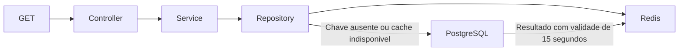

# Cache de sensores

As tres APIs usam Redis no `GET /get/sensores`. Cada dominio tem uma chave propria, compartilhada entre suas replicas: `aps:alagamento:sensores:v1`, `aps:qualidade-ar:sensores:v1` e `aps:transito:sensores:v1`.

O repository procura a lista no cache. Se nao encontrar, consulta o PostgreSQL e armazena o resultado por 15 segundos. Depois de cadastrar um sensor, remove a chave do dominio. Services e controllers continuam recebendo os mesmos modelos, com `createdAt` como Date ate a serializacao HTTP.



O cache e uma otimizacao opcional. Sem `REDIS_URL`, as consultas continuam diretamente pelo banco. Se o Redis falhar, o cliente tenta reconectar e as APIs usam PostgreSQL, sem enfileirar comandos para executar depois. Cada operacao de cache tem prazo de 500 ms. A readiness continua verificando o banco; a liveness verifica somente o processo.

O TTL limita a desatualizacao caso uma leitura concorrente reponha uma lista antiga depois da invalidacao ou a invalidacao falhe. Esta versao aceita essa consistencia eventual por ate 15 segundos. As consultas de leituras e a validacao de sensor durante a ingestao continuam diretamente no banco.

## Kubernetes

`k8s/11-cache.yaml` cria um Deployment com uma replica e Service `cache`, somente interno (ClusterIP). A imagem e `redis:8.2.3-alpine`; o ConfigMap fornece `REDIS_URL=redis://cache:6379` as APIs. Redis usa ate 64 MB para os dados e remove chaves por LRU quando necessario. O volume e temporario e a persistencia esta desabilitada: os cadastros permanecem no PostgreSQL e o cache pode ser reconstruido.

Este Redis nao tem autenticacao e nao e publicado no Ingress nem em NodePort. A configuracao destina-se ao cluster local da faculdade; para outros ambientes, devem ser definidos autenticacao e controles de rede.

As APIs com cache usam as imagens `:etapa3-v4`; o Job e os initContainers de migrations permanecem em `aps-migrate:etapa3-v2`, pois o schema nao mudou. Depois de construir as imagens pelo script habitual:

```powershell
kubectl apply -f k8s/11-cache.yaml -f k8s/01-configmap.yaml
kubectl rollout status deployment/cache -n aps --timeout=180s
kubectl apply -f k8s/05-api-alagamento.yaml -f k8s/06-api-qualidade-ar.yaml -f k8s/07-api-transito.yaml
kubectl get deployments,hpa -n aps
```

## Demonstrar armazenamento e expiracao

Consulte `GET http://localhost:30080/alagamento/get/sensores` no Postman e, em seguida:

```powershell
kubectl exec -n aps deployment/cache -- redis-cli GET aps:alagamento:sensores:v1
kubectl exec -n aps deployment/cache -- redis-cli TTL aps:alagamento:sensores:v1
kubectl exec -n aps deployment/cache -- redis-cli INFO stats
```

Repita o GET e observe `keyspace_hits`. Apos 15 segundos sem novas consultas, `TTL` retorna `-2`, indicando chave ausente. Um GET subsequente consulta o banco e recria a chave. As probes do Redis nao consultam essa chave.

Cadastre um sensor pelo `POST /alagamento/send/sensor` e verifique que a chave foi removida. A proxima consulta refaz a lista. Repita com `qualidade-ar` e `transito` para demonstrar o isolamento dos dominios.

Para demonstrar fallback, em um momento sem outros testes em execucao:

```powershell
kubectl scale deployment/cache -n aps --replicas=0
# Consulte GET /get/sensores nas tres APIs: deve continuar retornando 200.
kubectl scale deployment/cache -n aps --replicas=1
kubectl rollout status deployment/cache -n aps --timeout=180s
```

## Testes

`npm run test:cache` verifica cache, invalidacao, datas, listas vazias, isolamento e erros com dependencias simuladas. Para testar tambem o transporte real, use uma instancia Redis exclusiva de testes (o teste remove as tres chaves de cadastro):

```powershell
$env:TEST_REDIS_URL = 'redis://localhost:16379'
npm run test:cache
```

O teste com Redis sobe duas instancias HTTP de cada API com persistencia simulada, compartilhando Redis, e verifica serializacao, invalidacao entre replicas, expiracao e fallback. Sem `TEST_REDIS_URL`, somente essa integracao e ignorada. Nao substitui os testes PostgreSQL existentes, que dependem de `TEST_DATABASE_URL`.

A fila de mensagens sera implementada na proxima etapa. O item 12 da ficha ainda fica parcialmente pendente.

## Validacao executada em 05/11/2026

- Build e verificacao de tipos aprovados.
- Suite completa: 121 testes aprovados, zero falhas e zero ignorados, com PostgreSQL e Redis temporarios exclusivos de testes. Inclui as migrations existentes e o teste de Redis conectado sem responder, com fallback apos aproximadamente 500 ms e reconexao.
- No Docker Desktop, as tres APIs foram atualizadas para `etapa3-v4`, mantendo duas replicas por API e HPA de 2 a 10. Redis foi implantado com uma replica.
- Pelo Ingress, os tres dominios apresentaram chaves independentes, reutilizacao do cache, expiracao real de 15 segundos, invalidacao apos cadastro e resposta 409 para nome duplicado.
- Redis foi temporariamente reduzido a zero replicas: `GET /get/sensores`, liveness e readiness continuaram retornando 200 nas tres APIs. Apos restaurar uma replica, as chaves voltaram a ser preenchidas.
- Os tres sensores temporarios foram removidos. As listas voltaram aos mesmos IDs anteriores ao teste: 3 sensores de alagamento, 5 de qualidade do ar e 4 de transito. Nenhuma leitura foi criada ou removida no cluster.

O teste de escala por CPU sob carga continua sendo uma demonstracao separada; nao foi executado nesta validacao de cache.

Referencias: [cliente oficial Node.js](https://github.com/redis/node-redis) e [politicas de remocao do Redis](https://redis.io/docs/latest/develop/reference/eviction/).
