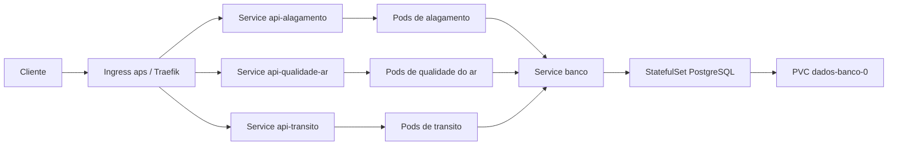

# Etapa 3 - Implantacao no Kubernetes

Esta etapa acrescenta a orquestracao das imagens da etapa 2. As APIs, os contratos TypeScript, os nove tipos de sensor, os timestamps dos dispositivos, as migrations e o banco unico foram preservados. O Compose continua disponivel para desenvolvimento.

## O que o objetivo pede e onde esta implementado

| Requisito da ficha | Implementacao |
|---|---|
| Aplicar a pasta com um comando | `kubectl apply -f k8s/`, depois da preparacao das imagens e do Secret local |
| Um Deployment e um Service por servico, minimo tres | `05-api-alagamento.yaml`, `06-api-qualidade-ar.yaml`, `07-api-transito.yaml` |
| Imagens de tag fixa | Quatro imagens do projeto com `:etapa3-v1`; PostgreSQL `16.14-bookworm`, Traefik `v3.7.15`, metrics-server `v0.9.0` |
| Ingress como entrada unica e roteamento por caminho | `08-gateway.yaml`, classe `aps-traefik`, controller Traefik e tres prefixos |
| Probes de liveness e readiness distintas | Nas APIs: `/health/live` verifica o processo; `/health/ready` executa `SELECT 1` no banco a cada chamada |
| Requests e limits de CPU e memoria | Configurados em todos os containers, incluindo initContainers, Job, banco, gateway e metrics-server |
| RollingUpdate | `maxUnavailable: 0`, `maxSurge: 1`, `minReadySeconds: 5` e `preStop` de 5 segundos nas APIs |
| ConfigMap comum | `01-configmap.yaml`, com ambiente, banco e portas |
| Credenciais em Secret, fora do repositorio | `.env.k8s` e `k8s/02-secret.local.yaml`, ambos ignorados pelo Git; modelo em `scripts/k8s/secret.example.yaml` |
| Banco persistente em StatefulSet | `03-banco.yaml`, PostgreSQL unico, PVC `dados-banco-0` de 1 GiB e retencao do volume |
| HPA por CPU e metrics-server respondendo | `09-autoscaling.yaml` e `10-metrics-server-local.yaml`; um HPA por API, de 1 a 3 replicas, alvo de 60% |
| Schema pronto antes das APIs | Job `aps-migrate-etapa3-v1`; initContainers aguardam todas as migrations da imagem estarem aplicadas |

O namespace da aplicacao e `aps`. O metrics-server usa `kube-system` e registra a API de metricas no cluster. Os manifests desta pasta foram preparados para um cluster local Docker Desktop, com Kubernetes 1.34 ou superior.



## 1. Habilitar o cluster no Docker Desktop

Inicie o Docker Desktop em Linux containers. Na area Kubernetes, crie ou habilite o cluster e aguarde os nodes ficarem prontos. Para seguir este guia com imagens locais, selecione o provisionador **kubeadm**, de um node. O provisionador kind do Docker Desktop usa um fluxo diferente para disponibilizar imagens nos nodes.

No PowerShell do VS Code, na raiz do repositorio:

```powershell
kubectl config use-context docker-desktop
kubectl get nodes -o wide
kubectl version
kubectl get storageclass
```

O node deve estar `Ready` e deve existir uma StorageClass marcada como `(default)`. O PVC usa essa classe para solicitar o disco. Reserve recursos suficientes para o cluster; 4 CPUs e 6 GiB de memoria no Docker Desktop sao um ponto de partida para a demonstracao completa.

O controller de Ingress e o metrics-server estao incluidos na pasta, sem necessidade de Helm. O metrics-server usa `--kubelet-insecure-tls` para os certificados dos kubelets do ambiente local; essa configuracao deve ser revista ao levar os manifests para outro ambiente.

## 2. Construir as imagens existentes

```powershell
powershell -NoProfile -ExecutionPolicy Bypass -File scripts/k8s/build-imagens.ps1
```

O script usa os tres Dockerfiles existentes e o target `migrate`. Nao publica imagens e nao substitui as tags `1.1.0` usadas pelo Compose. Os Deployments usam `imagePullPolicy: IfNotPresent` para aproveitar as imagens locais.

Se um node nao encontrar essas imagens e mostrar `ImagePullBackOff`, confira a tag com `docker image ls` e o provisionador do cluster. Em clusters com nodes que nao compartilham o armazenamento de imagens do Docker Desktop, as quatro imagens devem ser carregadas nos nodes ou publicadas em um registry acessivel, com as referencias dos manifests ajustadas para a mesma tag fixa.

## 3. Preparar as credenciais locais

```powershell
Copy-Item .env.k8s.example .env.k8s
code .env.k8s
```

Defina uma senha propria em `POSTGRES_PASSWORD` e salve. Em seguida:

```powershell
powershell -NoProfile -ExecutionPolicy Bypass -File scripts/k8s/gerar-secret.ps1
```

O script cria `k8s/02-secret.local.yaml`. A mesma credencial gera o usuario do PostgreSQL e a `DATABASE_URL` das tres APIs e do Job, usando `banco:5432/aps`. Caracteres especiais do usuario e da senha sao codificados corretamente na URL. O pool e limitado a cinco conexoes por Pod.

Esse arquivo nao deve ser enviado aos colegas nem ao GitHub. Cada integrante gera seu Secret a partir da propria `.env.k8s`. O `.env` do Compose continua separado. Depois que o volume do PostgreSQL tiver sido inicializado, mantenha a credencial original: editar apenas o Secret nao troca a senha de um usuario ja existente no banco.

## 4. Aplicar tudo com um comando

```powershell
kubectl apply -f k8s/
```

Acompanhe a primeira inicializacao:

```powershell
kubectl rollout status statefulset/banco -n aps --timeout=300s
kubectl wait -n aps --for=condition=complete job/aps-migrate-etapa3-v1 --timeout=600s
kubectl rollout status deployment/api-alagamento -n aps --timeout=300s
kubectl rollout status deployment/api-qualidade-ar -n aps --timeout=300s
kubectl rollout status deployment/api-transito -n aps --timeout=300s
kubectl rollout status deployment/aps-gateway -n aps --timeout=300s
kubectl rollout status deployment/metrics-server -n kube-system --timeout=300s
kubectl wait --for=condition=Available apiservice/v1beta1.metrics.k8s.io --timeout=180s
kubectl get pods,svc,ingress,hpa,pvc -n aps
```

O Job aplica as migrations uma unica vez por versao. Os initContainers das APIs consultam `prisma migrate status` e aguardam o schema completo. Se algo falhar, consulte:

```powershell
kubectl logs -n aps job/aps-migrate-etapa3-v1
kubectl logs -n aps deployment/api-alagamento -c aguardar-migrations
kubectl describe pods -n aps
kubectl get events -n aps --sort-by=.metadata.creationTimestamp
```

O PostgreSQL do Kubernetes usa um volume proprio. Os dados do Compose nao sao copiados automaticamente para ele. As tres APIs do cluster compartilham esse unico banco.

## 5. Acessar as APIs pelo Ingress

Em um terminal dedicado, mantenha este comando aberto:

```powershell
kubectl port-forward -n aps service/aps-gateway 8080:80
```

O encaminhamento chega ao controller de Ingress. O Traefik escolhe a API pelo prefixo e remove esse prefixo antes de encaminhar a requisicao, preservando as rotas existentes:

| API | Base externa | Exemplo de consulta |
|---|---|---|
| Alagamento | `http://localhost:8080/alagamento` | `/alagamento/get/alagamento` |
| Qualidade do ar | `http://localhost:8080/qualidade-ar` | `/qualidade-ar/get/qualidade-ar` |
| Transito | `http://localhost:8080/transito` | `/transito/get/transito` |

Por exemplo, `/alagamento/send/sensor` chega a `/send/sensor` na API de alagamento. As portas das APIs e do banco ficam internas ao cluster. O Service do gateway tambem oferece NodePort `30080`, caso o ambiente permita acesso direto a essa porta.

Em outro terminal:

```powershell
Invoke-RestMethod http://localhost:8080/alagamento/health/ready
Invoke-RestMethod http://localhost:8080/qualidade-ar/health/ready
Invoke-RestMethod http://localhost:8080/transito/health/ready
```

Para cadastrar e enviar leituras de todos os sensores usando os simuladores existentes:

```powershell
$env:API_URL = 'http://localhost:8080/alagamento'
python api-alagamento-inundacao/req.py
$env:API_URL = 'http://localhost:8080/qualidade-ar'
python api-qualidade-do-ar/req.py
$env:API_URL = 'http://localhost:8080/transito'
python api-transito-e-transporte/req.py
Remove-Item Env:API_URL

Invoke-RestMethod http://localhost:8080/alagamento/get/sensores
Invoke-RestMethod http://localhost:8080/alagamento/get/alagamento
Invoke-RestMethod http://localhost:8080/qualidade-ar/get/sensores
Invoke-RestMethod http://localhost:8080/qualidade-ar/get/qualidade-ar
Invoke-RestMethod http://localhost:8080/transito/get/sensores
Invoke-RestMethod http://localhost:8080/transito/get/transito
```

O cadastro continua sendo por equipamento, cada leitura continua tendo uma unica medida e o timestamp continua sendo gerado pelo sensor. Os detalhes dos corpos JSON estao no [guia de sensores](sensores.md).

## 6. Demonstrar persistencia depois de excluir o Pod do banco

Cadastre um sensor com nome unico e grave uma leitura:

```powershell
$cadastro = @{ nome = "nivel-persistencia-$([DateTimeOffset]::UtcNow.ToUnixTimeMilliseconds())"; tipo = 'NIVEL' } | ConvertTo-Json
$sensor = Invoke-RestMethod -Method Post -Uri http://localhost:8080/alagamento/send/sensor -ContentType application/json -Body $cadastro
$dados = @{ sensorId = $sensor.id; timestamp = [DateTime]::UtcNow.ToString('yyyy-MM-ddTHH:mm:ss.fffZ'); nivelCorregoCm = 120.5 } | ConvertTo-Json
$leitura = Invoke-RestMethod -Method Post -Uri http://localhost:8080/alagamento/send/alagamento -ContentType application/json -Body $dados

kubectl get pvc -n aps
kubectl delete pod banco-0 -n aps
kubectl rollout status statefulset/banco -n aps --timeout=180s
kubectl rollout status deployment/api-alagamento -n aps --timeout=180s

$persistida = @(Invoke-RestMethod http://localhost:8080/alagamento/get/alagamento) | Where-Object id -eq $leitura.id
if (-not $persistida -or $persistida.nivelCorregoCm -ne 120.5 -or $persistida.timestamp -ne $leitura.timestamp) { throw 'Leitura nao preservada.' }
$persistida
```

O StatefulSet recria `banco-0` e remonta `dados-banco-0`. Excluir o Pod preserva o volume. Excluir o PVC, apagar o namespace ou resetar o cluster pode remover os dados.

## 7. Demonstrar readiness sem reiniciar as APIs

Este teste interrompe temporariamente apenas o banco do namespace `aps`. A restauracao fica no `finally`:

```powershell
try {
  kubectl scale statefulset/banco -n aps --replicas=0
  Start-Sleep -Seconds 20
  kubectl get pods -n aps -l 'app in (api-alagamento,api-qualidade-ar,api-transito)'
  $pod = kubectl get pod -n aps -l app=api-alagamento -o jsonpath='{.items[0].metadata.name}'
  kubectl exec -n aps $pod -c api -- node -e "Promise.all(['/health/live','/health/ready'].map(async p => { const r = await fetch('http://127.0.0.1:3001'+p); console.log(p, r.status) }))"
} finally {
  kubectl scale statefulset/banco -n aps --replicas=1
  kubectl rollout status statefulset/banco -n aps --timeout=180s
  kubectl rollout status deployment/api-alagamento -n aps --timeout=180s
  kubectl rollout status deployment/api-qualidade-ar -n aps --timeout=180s
  kubectl rollout status deployment/api-transito -n aps --timeout=180s
}
```

Durante a parada, as APIs devem aparecer `0/1`, com o mesmo contador de restarts observado antes do teste. A chamada interna a `/health/live` continua retornando 200 e `/health/ready` retorna 503. O Service deixa de enviar trafego aos Pods sem readiness; pelo Ingress pode aparecer 503 ou 404 enquanto nao houver backend disponivel. Ao restaurar o banco, os Pods voltam a ficar prontos.

## 8. Demonstrar metricas, HPA e balanceamento

Primeiro confirme que existem amostras de CPU e memoria:

```powershell
kubectl get apiservice v1beta1.metrics.k8s.io
kubectl top nodes
kubectl top pods -n aps
kubectl get hpa -n aps
```

Na primeira inicializacao as metricas podem levar alguns instantes para aparecer. Se `kubectl top` falhar ou o HPA continuar com `<unknown>`, consulte `kubectl logs -n kube-system deployment/metrics-server` e `kubectl describe hpa -n aps`.

Com o encaminhamento da porta ainda ativo, gere requisicoes por tres minutos:

```powershell
node scripts/k8s/carga.mjs http://localhost:8080/alagamento/health/live 180 32
```

Em outro terminal:

```powershell
kubectl get hpa -n aps -w
# Em outro terminal, acompanhe os Pods:
kubectl get pods -n aps -l app=api-alagamento -w
```

O alvo e 60% do request de 100m de CPU, isto e, aproximadamente 60m por Pod. O HPA pode aumentar ate tres replicas quando a CPU observada exceder o alvo. Se a carga nao atingir o alvo, aumente a concorrencia para 64 ou a duracao; observe as metricas em vez de assumir que houve escala. Depois da carga, a janela de estabilizacao de reducao e de 120 segundos.

Com mais de uma replica pronta, os logs de acesso do Traefik permitem conferir os diferentes enderecos de backend:

```powershell
kubectl get pods -n aps -l app=api-alagamento -o wide
kubectl logs -n aps deployment/aps-gateway --tail=100
```

Compare os campos `ServiceAddr` das requisicoes da API com os IPs dos Pods. Os Services mantem nomes estaveis; o Ingress distribui as chamadas entre os endpoints prontos.

## 9. Demonstrar RollingUpdate

```powershell
kubectl rollout restart deployment/api-alagamento -n aps
kubectl rollout status deployment/api-alagamento -n aps --timeout=180s
kubectl rollout history deployment/api-alagamento -n aps
```

O Kubernetes cria um Pod adicional e exige que ele permaneca pronto por cinco segundos antes de remover o anterior. O `preStop` mantem o processo anterior disponivel por mais cinco segundos enquanto a retirada do endpoint se propaga ao Ingress. Essa configuracao foi validada com requisicoes continuas durante a troca do Pod.

Para uma nova entrega de codigo, use uma nova tag fixa e atualize as referencias dos manifests. Se houver novas migrations, atualize tambem a imagem e o nome versionado do Job, pois Jobs concluidos nao sao executados novamente apenas por reaplicar o mesmo arquivo.

## Evidencias para preencher a ficha

Consulte os [resultados da execucao de 17/10/2026](resultados-testes.md) e o [registro JSON](evidencias-etapa3.json). Esses arquivos documentam uma execucao concluida; a disponibilidade atual depende de o Docker Desktop e o cluster estarem ligados.

Depois que todos os recursos estiverem prontos, os testes de ponta a ponta podem ser repetidos com:

```powershell
node scripts/k8s/testar.mjs
```

O script usa exclusivamente o contexto `docker-desktop` e o namespace `aps`. Ele valida as tres APIs pelo Ingress, cadastra nove sensores de teste, verifica as leituras, recria o Pod do banco para conferir a persistencia, pausa e restaura o banco para conferir as probes, executa um RollingUpdate e gera carga para verificar os tres HPAs e o balanceamento. Execute durante a demonstracao ou em ambiente de testes, pois a verificacao inclui uma interrupcao temporaria do banco.

O resultado e gravado em `evidencias/kubernetes.local.json`, ignorado pelo Git. Uma falha encerra o script com erro e fica registrada nesse arquivo; o banco e restaurado mesmo se uma verificacao falhar.

```powershell
kubectl get nodes -o wide
kubectl get deploy -n aps -o wide
kubectl get svc -n aps
kubectl get ingress -n aps
kubectl describe pod -n aps -l app=api-alagamento
kubectl get configmap -n aps
kubectl get secret -n aps
kubectl get statefulset,pvc -n aps
kubectl get hpa -n aps
kubectl top pods -n aps
```

Registre a saida desses comandos e as demonstracoes de persistencia, readiness e escala. `kubectl get secret` mostra somente os nomes; nao use `-o yaml` nas evidencias do grupo.

## Referencias

- [Docker Desktop: Kubernetes e provisionadores](https://docs.docker.com/desktop/use-desktop/kubernetes/)
- [Kubernetes: liveness, readiness e startup probes](https://kubernetes.io/docs/tasks/configure-pod-container/configure-liveness-readiness-probes/)
- [Kubernetes: Horizontal Pod Autoscaling](https://kubernetes.io/docs/tasks/run-application/horizontal-pod-autoscale/)
- [Traefik: provider Kubernetes Ingress](https://doc.traefik.io/traefik/v3.7/reference/install-configuration/providers/kubernetes/kubernetes-ingress/)
- [Traefik: StripPrefix](https://doc.traefik.io/traefik/reference/routing-configuration/http/middlewares/stripprefix/)
- [Metrics Server: instalacao e compatibilidade](https://github.com/kubernetes-sigs/metrics-server)
