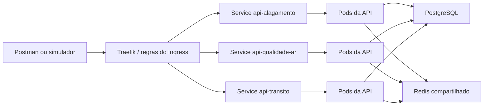

# Kubernetes — guia principal para a apresentação

Leia também: [APIs](api.md) · [Docker](docker.md).

## 1. O que estamos demonstrando

Kubernetes mantém o estado definido nos YAMLs: imagens, réplicas, comunicação e condições para receber tráfego.

Usamos **Docker Desktop, provisionador kubeadm e um nó**. Nó é a máquina que executa os pods; pod contém os containers. O namespace `aps` agrupa a aplicação; metrics-server fica em `kube-system`.

Demonstramos distribuição de requisições, recuperação e escala. Com um nó, banco e broker únicos, não há tolerância à perda da máquina inteira.

## 2. Quais componentes existem

| Componente | Recurso principal | Função e configuração |
|---|---|---|
| Três APIs | Um Deployment e Service por API | Réplicas controladas por HPA, entre 2 e 10 por API. |
| Gateway Traefik | Deployment, Service e Ingress | Entrada HTTP única; uma réplica. |
| PostgreSQL | StatefulSet e PVC | Banco compartilhado; uma réplica e volume de 1 GiB. |
| Redis | Deployment e Service | Cache de sensores; uma réplica, dados temporários. |
| RabbitMQ | StatefulSet e PVC | Fila de alertas; uma réplica e volume de 1 GiB. |
| Worker | Deployment e Service de health | Publica e consome mensagens; uma réplica. |
| Migrations | Job | Aplica as mudanças versionadas do banco e termina. |
| Metrics-server | Deployment em `kube-system` | Fornece métricas usadas pelo HPA e pelo `kubectl top`. |

**Deployment** mantém réplicas e coordena atualizações. **Service** identifica pods pelos labels e oferece nome estável: `banco` para PostgreSQL, `cache` para Redis e `fila` para RabbitMQ.

**StatefulSet** mantém identidades como `banco-0` e `fila-0`. **PVC** solicita armazenamento persistente. Os volumes são retidos ao reduzir réplicas ou excluir o StatefulSet. Redis usa dados temporários, reconstruídos do banco.

## 3. Como uma requisição chega à API



Ingress declara as regras; Traefik executa o roteamento entre os endpoints prontos dos Services.

A entrada local é `http://localhost:30080`: NodePort → Service `aps-gateway:80` → Traefik na porta 8000.

| Caminho externo | API selecionada |
|---|---|
| `/alagamento/...` | `api-alagamento:3001` |
| `/qualidade-ar/...` | `api-qualidade-ar:3002` |
| `/transito/...` | `api-transito:3003` |

Traefik remove o prefixo: `/alagamento/send/sensor` chega como `/send/sensor`. O histórico fica em `http://localhost:30080/alagamento/get/alagamento`.

Também podemos encaminhar uma porta local ao mesmo gateway:

```sh
kubectl port-forward -n aps service/aps-gateway 8080:80
```

Mantenha esse terminal aberto e use `http://localhost:8080` com os mesmos prefixos, passando pelo Ingress.

## 4. Configuração, credenciais e ordem de inicialização

**ConfigMap `aps-config`** contém portas, endereço do Redis e limites de alerta. **Secrets `aps-db` e `aps-fila`** fornecem credenciais de PostgreSQL e RabbitMQ. Valores reais ficam fora do Git.

O Job `aps-migrate-etapa3-v5` aplica migrations. InitContainers das APIs e do worker aguardam sua aplicação antes de iniciar os processos principais. A inicialização depende dessas verificações, além da criação dos recursos.

APIs e migrations usam imagens `etapa3-v5`; worker usa `etapa3-v5.1`. Os demais componentes também têm tags fixas nos manifests.

### Como subir em uma máquina preparada

Habilite Kubernetes no Docker Desktop e aguarde o nó `Ready`. Na primeira configuração, copie `.env.k8s.example` para `.env.k8s` e defina uma senha. Na raiz, em PowerShell:

```powershell
kubectl config use-context docker-desktop
kubectl get nodes
powershell -NoProfile -ExecutionPolicy Bypass -File scripts/k8s/gerar-secret.ps1
node scripts/k8s/gerar-secret-fila.mjs
powershell -NoProfile -ExecutionPolicy Bypass -File scripts/k8s/build-imagens.ps1
kubectl apply -f k8s/
```

No macOS/Linux com PowerShell instalado, use `pwsh` no lugar de `powershell`. Reutilize Secrets existentes e preserve as credenciais dos volumes inicializados.

Acompanhe a preparação:

```sh
kubectl wait -n aps --for=condition=complete job/aps-migrate-etapa3-v5 --timeout=600s
kubectl rollout status deployment/api-alagamento -n aps --timeout=300s
kubectl rollout status deployment/api-qualidade-ar -n aps --timeout=300s
kubectl rollout status deployment/api-transito -n aps --timeout=300s
kubectl rollout status deployment/worker-alertas -n aps --timeout=300s
kubectl get pods,svc,ingress,hpa,pvc -n aps
```

As imagens devem estar disponíveis no cluster. A StorageClass do Docker Desktop provisiona os volumes, separados daquele usado pelo Compose.

## 5. Como verificamos se o sistema está saudável

| Probe | Pergunta que responde | Comportamento nas APIs |
|---|---|---|
| Startup | O processo terminou de iniciar? | Consulta `/health/live` durante a inicialização. |
| Liveness | O processo continua respondendo? | `/health/live`; não depende do banco. Falhas repetidas podem reiniciar o container. |
| Readiness | Este pod consegue atender agora? | `/health/ready` executa `SELECT 1` no PostgreSQL a cada chamada. |

Um pod não pronto sai dos endpoints de tráfego. Parar o banco afeta readiness, sem provocar reinícios por liveness nas APIs.

No worker, readiness verifica **banco e RabbitMQ**. Redis indisponível provoca consulta ao banco. RabbitMQ parado mantém leituras e trabalhos salvos, aguardando processamento.

## 6. Escala, recursos e atualização

Cada API tem HPA com **2 a 10 réplicas e alvo médio de CPU de 60%**. Metrics-server fornece medições; HPA ajusta a quantidade no Deployment, que cria ou remove pods.

As APIs têm requests de `100m`/`128Mi` e limits de `500m`/`256Mi` (CPU/memória). `100m` é 0,1 CPU: o alvo do HPA equivale a aproximadamente **60m por pod**. Requests orientam o agendamento; limits limitam consumo. Todos os containers têm esses recursos configurados.

O crescimento permite uma réplica a cada 30 segundos. A redução tem estabilização de 120 segundos e retira uma por 60 segundos. O nó precisa ter recursos para os pods solicitados.

Os Deployments omitem `spec.replicas`, deixando o controle ao HPA. Uma escala manual para quatro pode ser reajustada por ele.

**RollingUpdate** usa `maxUnavailable: 0` e `maxSurge: 1`: preserva a quantidade disponível enquanto cria uma réplica extra. Há cinco segundos de `minReadySeconds` e espera de cinco segundos antes de encerrar. Código novo exige nova imagem, tag no manifest e aplicação do Deployment.

## 7. Cache e processamento assíncrono no cluster

As réplicas compartilham chaves de sensores no Redis, válidas por 15 segundos. Uma réplica pode reutilizar o resultado obtido por outra. PostgreSQL mantém os dados persistidos.

A API grava **leitura e trabalho pendente juntos**. O worker publica no RabbitMQ e remove o trabalho após confirmação do envio. No consumo, aplica a regra, salva o alerta e confirma o processamento. O banco impede duplicidade por domínio e ID da leitura.

RabbitMQ usa filas duráveis, mensagens persistentes e PVC; worker tem uma réplica. Uma interrupção adia os alertas, permitindo retomar trabalhos salvos. Veja as regras no [guia das APIs](api.md).

## 8. Roteiro para mostrar ao professor

Primeiro apresente a estrutura e as métricas:

```sh
kubectl get deploy,statefulset,svc,ingress,hpa,pvc -n aps
kubectl top pods -n aps
kubectl get pods -n aps -o wide
kubectl logs -n aps deployment/aps-gateway --tail=30
kubectl logs -n aps deployment/worker-alertas --tail=20
```

Depois demonstre:

1. Cadastro, leitura e alerta pelo Postman, sempre passando pelo Ingress.
2. Requisições atendidas por diferentes pods. Os logs JSON do gateway mostram `ServiceAddr`, que pode ser relacionado ao IP do pod. O projeto usa essa evidência; não adiciona atualmente o cabeçalho `X-Pod`.
3. Exclusão de um pod de API e tempo até o substituto ficar pronto.
4. Persistência após recriar o pod do PostgreSQL e retirada das APIs do tráfego ao parar o banco, sem reinícios por liveness.
5. Aumento automático acima das duas réplicas iniciais sob carga. Duas réplicas, sozinhas, não comprovam atuação do HPA. A ficha também pede demonstrar escala manual para quatro.

Na última validação, passaram 131 testes, incluindo integrações. Cache, recuperação do RabbitMQ e reenvio sem duplicatas foram demonstrados. Ainda faltam as evidências finais de balanceamento, recuperação cronometrada, PostgreSQL e HPA sob carga para a ficha.

Os testes de falha interrompem componentes e exigem restaurá-los. Roteiros completos: [Kubernetes](../kubernetes.md) e [alertas](../alertas.md).

Arquivos para abrir durante a explicação: [Deployment de uma API](../../k8s/05-api-alagamento.yaml), [Ingress e gateway](../../k8s/08-gateway.yaml), [HPA](../../k8s/09-autoscaling.yaml), [banco](../../k8s/03-banco.yaml) e [worker](../../k8s/13-worker-alertas.yaml). Referências oficiais: [probes](https://kubernetes.io/docs/concepts/workloads/pods/probes/) e [HPA](https://kubernetes.io/docs/concepts/workloads/autoscaling/horizontal-pod-autoscale/).
